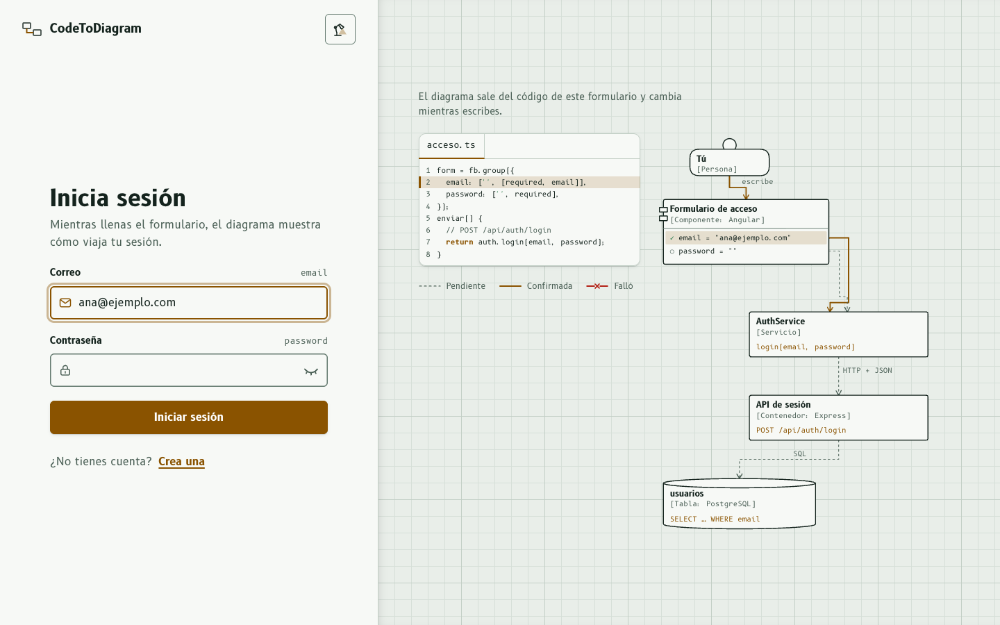
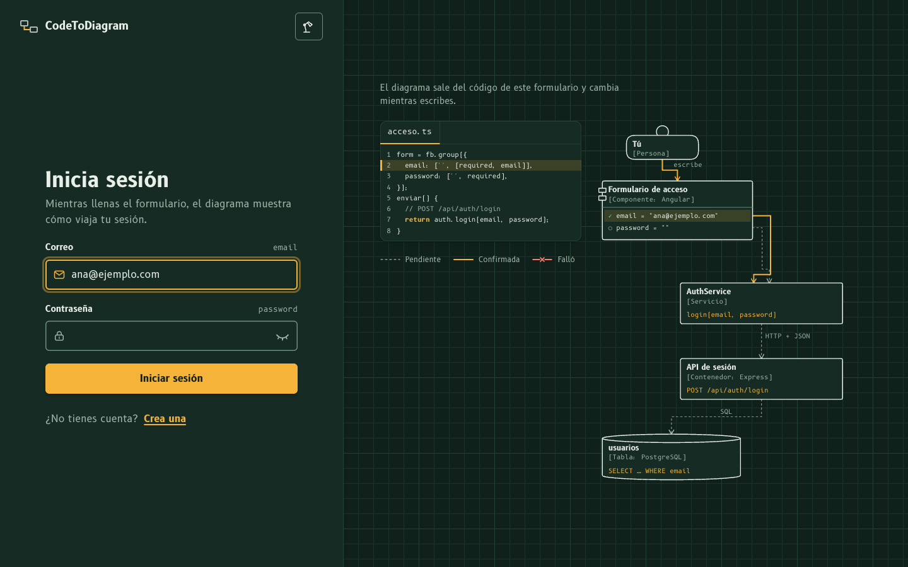
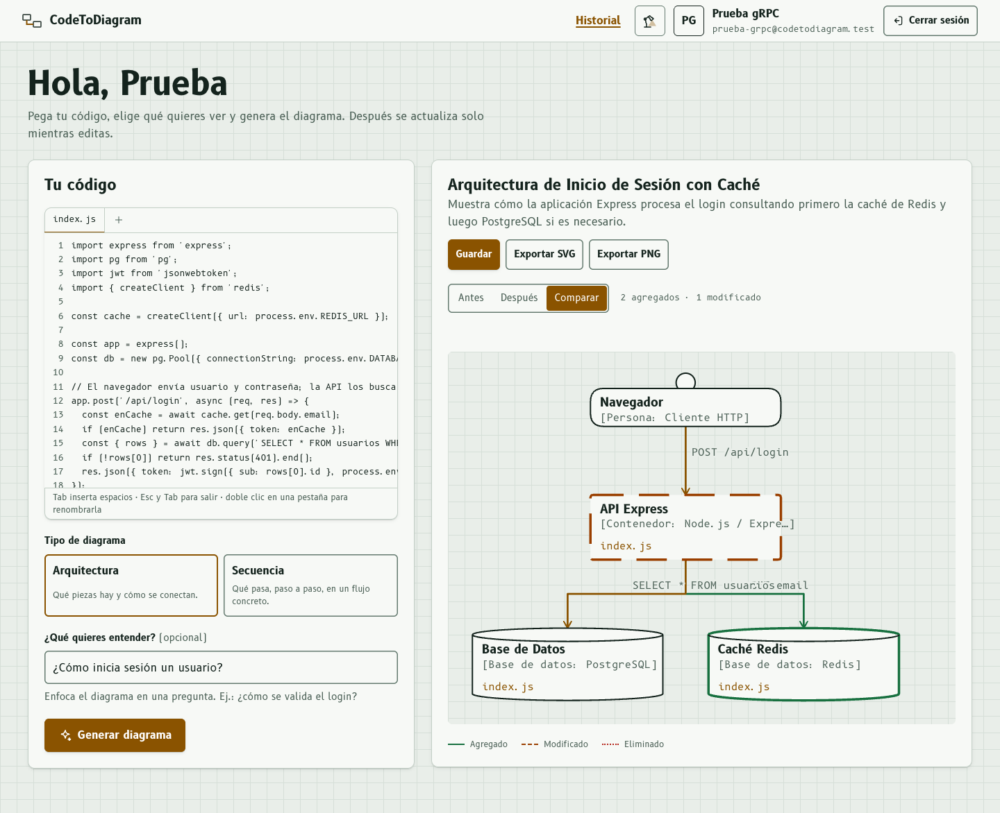
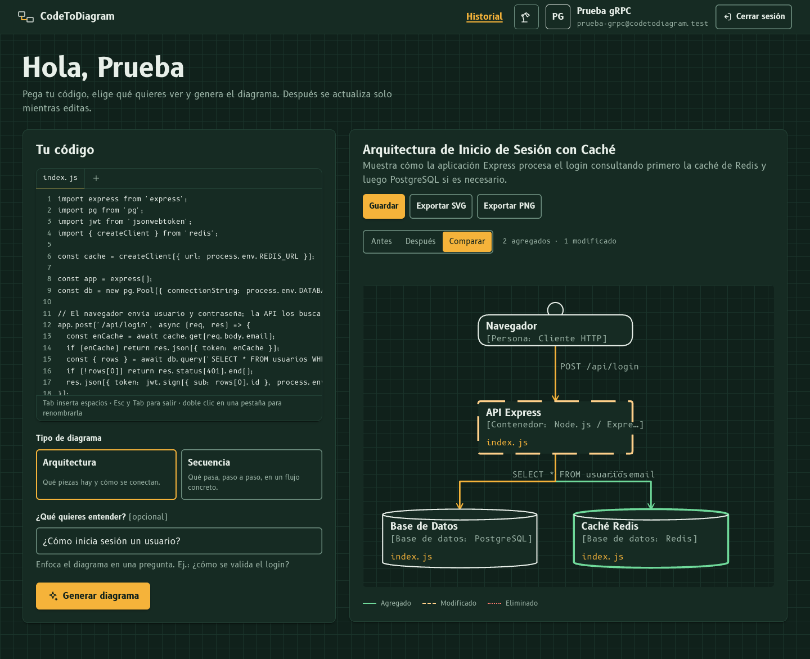
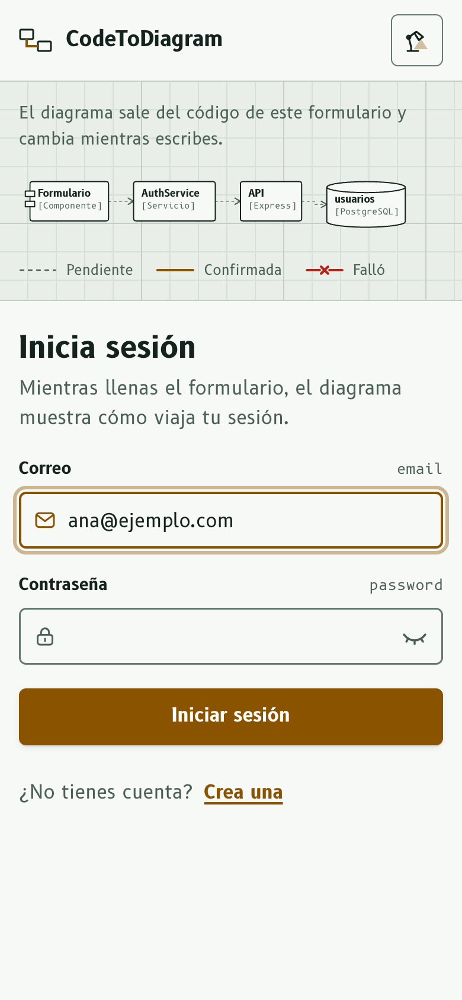
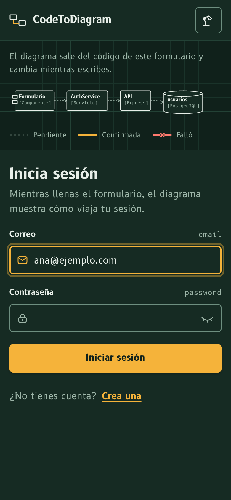
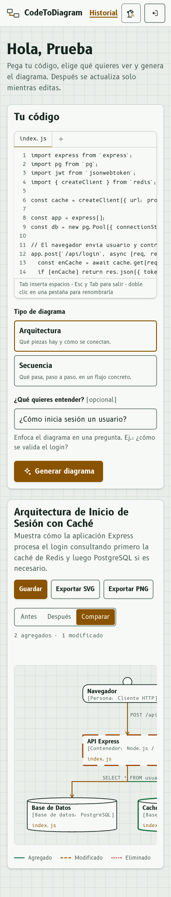
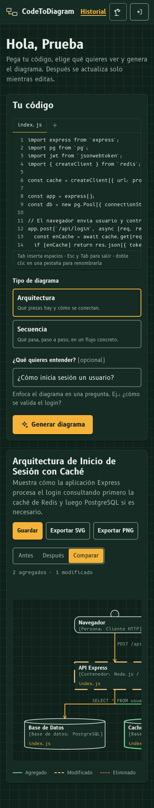
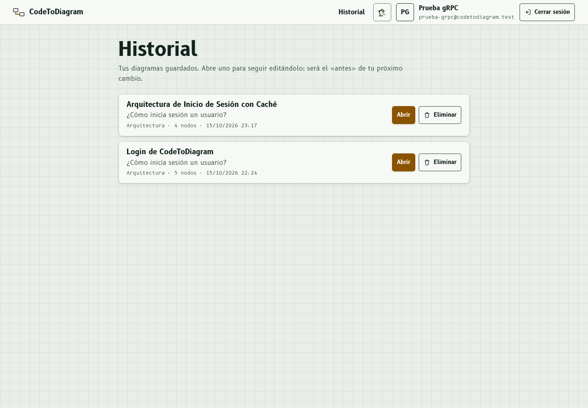
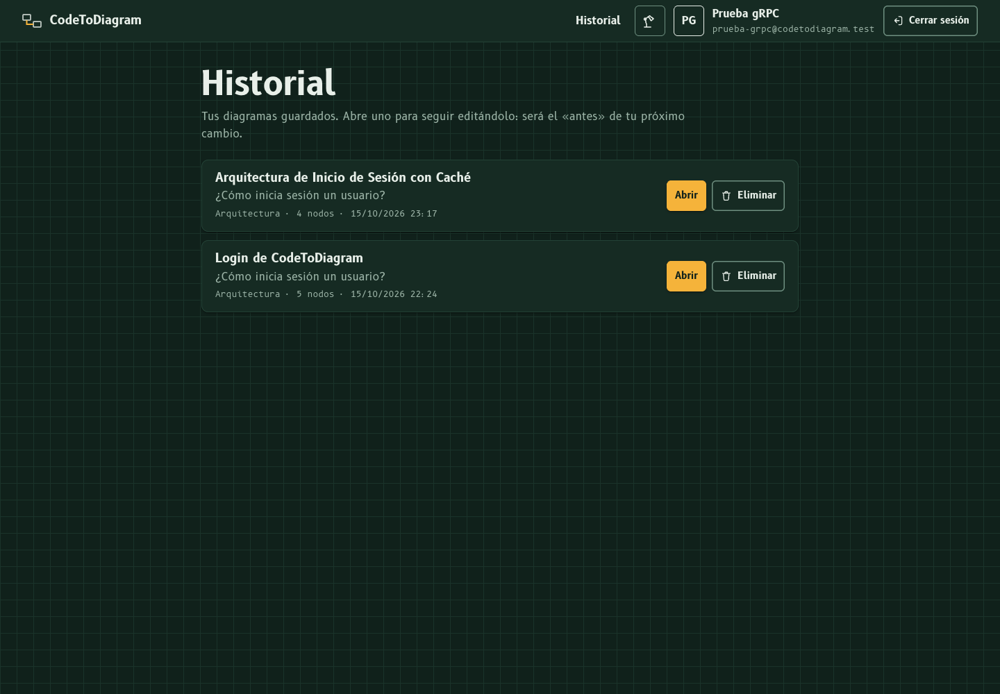

# CodeToDiagram · Frontend

**CodeToDiagram** es un visualizador reactivo de arquitectura: pegas código (uno o varios archivos) y la app dibuja su diagrama de arquitectura o de secuencia. Al editar el código, el diagrama se actualiza solo y **muestra qué cambió**: lo agregado, lo modificado y lo eliminado, con vistas Antes / Después / Comparar. Gemini analiza el código y devuelve nodos y conexiones; el backend lo valida y lo envía por gRPC; este frontend lo vuelve a validar y lo dibuja con un layout determinista.

Proyecto 1 de la materia Programación orientada a la web. Angular 22 (standalone, signals, sin SSR, CSS plano, SVG propio) y gRPC-Web con Connect.

Backend: <https://github.com/nicolaswagimin/pow-proyecto1-backend>

## Capturas

El acceso es una demostración del producto: mientras llenas el formulario, a la derecha se ve su propio código y su diagrama C4. Los campos válidos pasan de lápiz a tinta; al enviar, un paquete recorre el flujo y, si algo falla, el diagrama marca dónde.

El espacio de trabajo: código a la izquierda; a la derecha, el diagrama después de agregar una caché Redis al código, en la vista Comparar (verde: agregado; ámbar discontinuo: modificado).

| | Claro | Oscuro |
|---|---|---|
| Acceso, escritorio |  |  |
| `/app`, escritorio |  |  |
| Acceso, móvil |  |  |
| `/app`, móvil |  |  |
| `/historial` |  |  |

## Requisitos

- Node.js 22.22.3+ o 24.15+ (lo exige Angular 22). En Vercel: *Settings → Build and Deployment → Node.js Version* en 22.x o superior.
- El backend corriendo en <http://localhost:3001>.

## Correr en local

```bash
npm install
npm start          # ng serve en http://localhost:4201
```

El puerto está fijo en `angular.json`, así los tres proyectos pueden correr a la vez (desde la carpeta raíz, `./demo.sh` arranca todo).

Pruebas y contrato gRPC:

```bash
npm test -- --watch=false   # Vitest: validador, diff, layouts, exportación, espacio de trabajo…
npm run proto:check         # la copia del .proto es idéntica a la del backend
npm run proto:sync && npm run proto:gen   # tras cambiar el .proto en el backend
```

Para compilar la versión de producción:

```bash
npm run build      # genera dist/pow-proyecto1-frontend/browser
```

## Rutas

| Ruta | Qué muestra |
|---|---|
| `/` | Redirige a `/app` si hay sesión, o a `/login` si no. |
| `/login` | Inicio de sesión con el diagrama en vivo del formulario. |
| `/registro` | Crear cuenta. Comparte componente con `/login`: el diagrama se reacomoda. |
| `/app` | Protegida. Espacio de trabajo: editor, tipo, pregunta y diagrama con diff. `?diagrama=<id>` abre uno guardado. |
| `/historial` | Protegida. Diagramas guardados: abrir y eliminar. |
| `/design` | Guía de estilo viva: tokens, notación del diagrama y componentes. |

## Entornos (URL del backend)

| Archivo | Se usa con | `apiUrl` (REST) | `grpcUrl` (gRPC-Web) |
|---|---|---|---|
| `src/environments/environment.development.ts` | `ng serve` (local) | `http://localhost:3001/api` | `http://localhost:3001` |
| `src/environments/environment.ts` | `ng build` (producción) | `https://pow-proyecto1-backend.onrender.com/api` | `https://pow-proyecto1-backend.onrender.com` |

## Desplegar en Vercel

1. Despliega primero el backend en Render como `pow-proyecto1-backend`.
2. En <https://vercel.com> crea un **New Project** e importa este repositorio.
3. Configura **Framework Preset:** Angular, **Build Command:** `npm run build`, **Output Directory:** `dist/pow-proyecto1-frontend/browser`.
4. Agrega la URL de Vercel a `FRONTEND_URL` del backend en Render (sin `/` final) para que CORS la permita.

`vercel.json` reescribe todas las rutas a `/index.html`, así que recargar `/login` o `/app` no da 404.

## Documentación

| Documento | Contenido |
|---|---|
| [docs/funcionalidades.md](docs/funcionalidades.md) | Qué hace cada pantalla |
| [docs/diagramas.md](docs/diagramas.md) | Validación, layouts, diff, vistas y exportación |
| [docs/grpc-cliente.md](docs/grpc-cliente.md) | Transporte gRPC-Web, interceptores, errores y sincronización del `.proto` |
| [docs/brief-diseno.md](docs/brief-diseno.md) | Concepto "Mesa de trazado", demostración del login, direcciones descartadas |
| [docs/design-system.md](docs/design-system.md) | Tokens de color (con contraste), tipografía, espaciado, radios, sombras y movimiento |
| [docs/componentes.md](docs/componentes.md) | Cada componente con sus inputs, outputs y estados |
| [docs/animaciones.md](docs/animaciones.md) | Qué comunica cada animación y cómo se reduce |
| [docs/accesibilidad.md](docs/accesibilidad.md) | Decisiones de accesibilidad y resultado de axe |
| [docs/arquitectura-frontend.md](docs/arquitectura-frontend.md) | Carpetas, rutas, servicios, guards, interceptores y flujos de un login y de una edición |
| [docs/decisiones/](docs/decisiones/) | ADR: SVG propio con C4, login como demostración, B612, movimiento con motivo, editor propio, gRPC-Web, layout por capas, validar en el cliente |
| [CHANGELOG.md](CHANGELOG.md) | Cambios agrupados |

## Estructura

```
proto/                  copia sincronizada del contrato gRPC del backend
src/
  styles/tokens.css     todos los tokens de diseño
  app/core/             sesión, guards, interceptor, tema, errores, fortaleza
  app/gen/              código generado del .proto
  app/services/         cliente gRPC-Web del servicio de diagramas
  app/diagrama/         ui-diagrama, secuencia, validación, diff, layouts, vistas y exportación
  app/ui/               componentes base (incluido el editor)
  app/layouts/          auth-layout y la barra de la app
  app/pages/            acceso, inicio (/app), historial y guía (/design)
```
